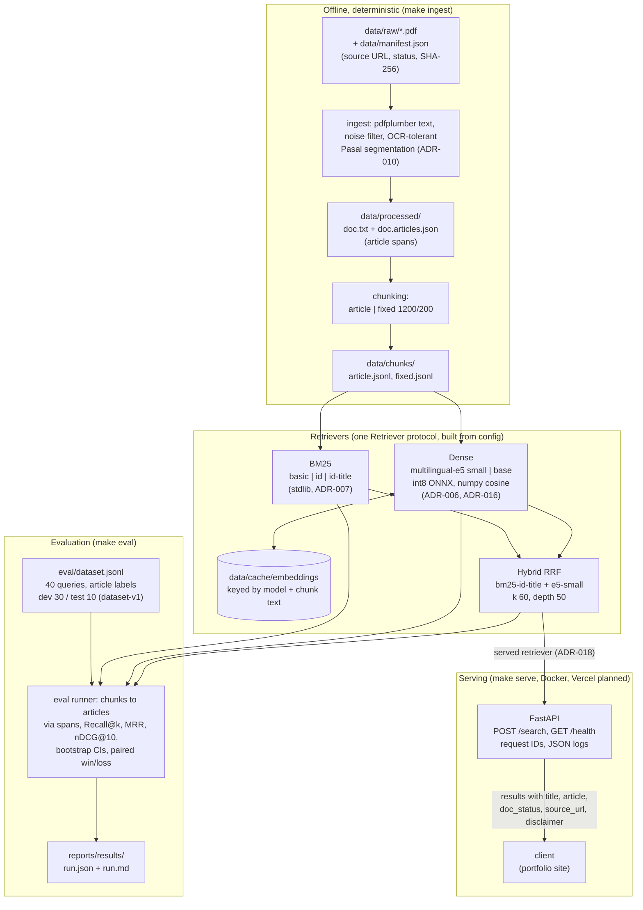

# IndoReg-RAG Eval

[](https://github.com/thisisaldi/indoreg-rag-eval/actions/workflows/ci.yml)

An evaluation-first retrieval benchmark over Indonesian personal data protection regulations. It compares BM25, dense and hybrid retrieval on a labeled query set, reports every comparison with confidence intervals, and serves the chosen configuration through a cited search API.

> **Not legal advice.** This project retrieves regulation passages for information. It only partly models amendments and revocations. Always check the text and status at the official source.

> **About the labels.** The 40 queries and their relevant-article labels were drafted by an LLM and checked by the same LLM against the official PDFs. **They are not human-verified** ([ADR-014](docs/decisions.md), [ADR-015](docs/decisions.md)). The corpus is 4 regulations, and the test split has 10 queries, so confidence intervals are wide.

## Problem

Compliance analysts search regulations by paraphrase ("can a company send customer data to a server abroad?"), not by article number. Keyword search misses terminology variants, and "chat with your docs" demos rarely measure whether the right article was found. This project measures that, with uncertainty, and documents where it fails.

## Results

Benchmark tag [`v0.1-benchmark`](https://github.com/thisisaldi/indoreg-rag-eval/releases/tag/v0.1-benchmark). The numbers below are from [`reports/results/20261023T074949Z-ed9dbfc.md`](reports/results/20261023T074949Z-ed9dbfc.md) (article chunks; the file also has fixed-size chunks and all paired comparisons). Cells are means with 95% bootstrap CIs over queries (1000 resamples, seed 42). Labels are article-level; tuning used the dev split only.

**Dev (30 queries)**

| retriever | nDCG@10 | MRR | Recall@10 |
|---|---|---|---|
| bm25-basic (baseline) | 0.566 [0.43, 0.69] | 0.603 [0.45, 0.74] | 0.683 [0.54, 0.82] |
| bm25-id-title (Indonesian stopwords, title indexed) | 0.581 [0.45, 0.71] | 0.629 [0.49, 0.76] | 0.707 [0.58, 0.83] |
| dense-e5-small (multilingual-e5-small, int8 ONNX) | 0.542 [0.41, 0.68] | 0.624 [0.47, 0.78] | 0.599 [0.45, 0.75] |
| dense-e5-base (multilingual-e5-base, int8 ONNX) | 0.643 [0.52, 0.76] | 0.693 [0.54, 0.84] | 0.716 [0.59, 0.84] |
| **hybrid** (RRF of bm25-id-title and dense-e5-small, served) | **0.659 [0.54, 0.77]** | **0.713 [0.59, 0.84]** | **0.797 [0.68, 0.90]** |

**Test (10 queries, frozen, never used for choices)**

| retriever | nDCG@10 | MRR | Recall@10 |
|---|---|---|---|
| bm25-basic | 0.423 [0.22, 0.64] | 0.495 [0.27, 0.74] | 0.700 [0.45, 0.90] |
| bm25-id-title | 0.563 [0.35, 0.76] | 0.653 [0.42, 0.87] | 0.800 [0.60, 1.00] |
| dense-e5-small | 0.528 [0.38, 0.68] | 0.599 [0.40, 0.82] | 0.800 [0.65, 0.95] |
| dense-e5-base | 0.448 [0.24, 0.65] | 0.531 [0.31, 0.76] | 0.650 [0.40, 0.85] |
| hybrid | 0.610 [0.40, 0.81] | 0.772 [0.54, 1.00] | 0.750 [0.55, 0.95] |

What the paired comparisons show (difference [95% CI], per-query wins/losses/ties):

- **Hybrid beats the BM25 baseline** on dev: nDCG@10 +0.093 [+0.01, +0.19] (14/6/10), Recall@10 +0.113 [+0.03, +0.21]. On test: nDCG@10 +0.187 [+0.03, +0.41], MRR +0.277 [+0.09, +0.51].
- **Hybrid vs the stronger BM25 variant** is borderline: dev nDCG@10 +0.078 [+0.0003, +0.151] (16/3/11). It is served ([ADR-018](docs/decisions.md)), but the gain is not robust.
- **Dense alone does not beat BM25** on dev (every CI includes 0). Dense and BM25 fail on different queries, which is why fusing them helps.
- **e5-base vs e5-small** is not established on dev: nDCG@10 +0.100 [-0.01, +0.21]. The smaller model is used in the hybrid because it fits a serverless deployment ([ADR-006](docs/decisions.md), [ADR-016](docs/decisions.md)).
- **Article chunks beat fixed-size chunks** (1200 characters, 200 overlap) on MRR and nDCG@10 for every retriever on dev (every CI excludes 0), for example hybrid MRR -0.291 [-0.41, -0.18] with fixed chunks; recall differences are smaller ([chunking ablation](reports/chunking_ablation.md)).
- **Terminology queries are the weak spot**: in the error-analysis run (before the heading fix, [ADR-017](docs/decisions.md)) the hybrid's mean dev nDCG@10 was 0.366 for terminology queries, against 0.677 to 0.898 for the other query types ([error analysis](reports/error_analysis.md), 10 failures with causes).

Latency (warm, in-process HTTP, this laptop): about 5 ms per query for BM25 and 18 ms for the hybrid at p50; cold start about 1 s for BM25 and 3 to 4 s with the model ([latency report](reports/latency.md)). Cash cost: none.

### Big-corpus stress test (local only)

The same 40 queries rerun on a corpus of 95,446 articles: the 4 labeled regulations plus 95,173 national-level articles (7,727 regulations, up to 2017) from the Hugging Face dump [`Azzindani/ID_REG_DB_2511`](https://huggingface.co/datasets/Azzindani/ID_REG_DB_2511) ([ADR-020](docs/decisions.md)). Numbers from [`reports/results/20261024T094427Z-5415577.md`](reports/results/20261024T094427Z-5415577.md); paired differences against the 4-document run in [`...vs-ed9dbfc.md`](reports/results/20261024T094427Z-5415577.vs-ed9dbfc.md).

| retriever (dev, 30 queries) | nDCG@10 | Recall@10 | nDCG@10 change vs 4 documents |
|---|---|---|---|
| bm25-basic | 0.321 [0.19, 0.46] | 0.394 [0.24, 0.54] | -0.244 [-0.37, -0.14] |
| bm25-id-title | 0.398 [0.27, 0.53] | 0.489 [0.34, 0.63] | -0.183 [-0.30, -0.08] |
| dense-e5-small | 0.401 [0.27, 0.54] | 0.471 [0.33, 0.62] | -0.142 [-0.23, -0.06] |
| hybrid | 0.484 [0.35, 0.63] | 0.562 [0.41, 0.71] | -0.174 [-0.28, -0.07] |

Every retriever drops. Labels cover only the 4 regulations, so a relevant article elsewhere counts as a miss, but a word-overlap check of the displaced results found 1 near-duplicate of a labeled article among 127 (8 more similar): most of the drop is distractors outranking the right article. Hybrid still beats bm25-basic on dev (+0.163 [+0.07, +0.27]). Reproduce with `make ingest-full eval-full` (11 GB download, about 1 hour of CPU embedding). The served API stays on the 4 regulations.

## Architecture



Details in [reports/architecture.md](reports/architecture.md) and [docs/design.md](docs/design.md).

## Reproduce

Requires [uv](https://docs.astral.sh/uv/); Python 3.12 is pinned and installed by uv if missing.

1. Download the 4 PDFs from the `source_url` of each entry in [`data/manifest.json`](data/manifest.json) into `data/raw/`, with the `filename` given there (they are not redistributed here). `uv run python scripts/check_manifest.py --strict` checks the SHA-256 hashes.
2. Run:

```
make install     # uv sync --locked
make test        # unit tests and the CI fixture eval
make ingest      # PDFs -> data/processed/ (text, article spans) -> data/chunks/
make eval        # all retrievers x chunk strategies -> reports/results/<run>.{json,md}
```

The first `make eval` downloads the two embedding models from the Hugging Face Hub at pinned revisions and caches chunk embeddings in `data/cache/`. A fresh clone reproduced the committed results exactly on the same machine: identical rankings and metrics for all 480 query rows ([T-23](docs/tasks.md)). Other platforms were not tested; onnxruntime float differences could change dense scores slightly.

Without `make` (for example on Windows), run the `uv run ...` commands in the [Makefile](Makefile). Settings live in [`configs/default.yaml`](configs/default.yaml); any key can be overridden with an `INDOREG_` environment variable, nested keys joined by `__` (for example `INDOREG_SEARCH__RETRIEVER=bm25-id-title`).

## Search API

Live demo: `https://indoreg-rag-eval.vercel.app` (Vercel Hobby, serving the hybrid; [OpenAPI docs](https://indoreg-rag-eval.vercel.app/docs)). Measured from Indonesia: server retrieval p50 9.9 ms, round trip p50 378 ms, mostly network to the US region (`reports/results/20261023T092147Z-25c0f58-remote.md`).


```
make serve       # http://127.0.0.1:8000, OpenAPI docs at /docs
```

```
curl -X POST http://127.0.0.1:8000/search \
  -H "Content-Type: application/json" \
  -d '{"query": "Apakah data biometrik termasuk data pribadi yang bersifat spesifik?", "top_k": 2}'
```

Response (first of the two results shown, text shortened; the text is the PDF's text layer, OCR errors included):

```json
{
  "request_id": "6e2d359c36064e6a8fb82e9c860bf41d",
  "query": "Apakah data biometrik termasuk data pribadi yang bersifat spesifik?",
  "retriever": "hybrid",
  "results": [
    {
      "rank": 1,
      "score": 0.03278688524590164,
      "text": "Pasal 4\n(l)\nData Pribadi terdiri atas:\na.\nData Pribadi yang bersifat spesifik; dan ...",
      "doc_id": "uu-27-2022",
      "title": "Undang-Undang Nomor 27 Tahun 2022 tentang Pelindungan Data Pribadi",
      "article": "4",
      "articles": ["4"],
      "doc_status": "in_force",
      "source_url": "https://peraturan.bpk.go.id/Details/229798/uu-no-27-tahun-2022"
    }
  ],
  "latency_ms": 93.774,
  "disclaimer": "Retrieval only. Not legal advice. Check amendment and revocation status at the source."
}
```

`top_k` defaults to 5 (1 to 20); queries must be 1 to 500 characters after trimming, otherwise the API returns 422. `GET /health` reports the retriever, chunk count and index build time. Every response carries an `X-Request-ID` header; logs are JSON, one line per request, and do not contain query text unless `logging.log_query_text` is enabled.

Docker (after `make ingest`; the model and embeddings are baked in, and the container runs offline as a non-root user):

```
docker build -t indoreg-search .
docker run --rm -p 8000:8000 indoreg-search
```

## Limitations

- **Labels are not human-verified.** An LLM drafted and checked them (ADR-015). Label errors would bias every number above.
- **Small evaluation.** 4 regulations (273 articles), 40 queries: 30 dev and 10 test. Most differences between similar systems are not statistically established.
- **Amendments are only partly modeled.** UU 11/2008 is in its original 2008 text; BPK lists amendments (UU 19/2016, UU 1/2024) and a partial revocation by UU 1/2023. Two queries (q-022, q-033) are labeled with provisions that may be revoked ([label notes](eval/LABEL_ISSUES.md)). The API returns each document's status; it does not track article-level changes.
- **Explanations (Penjelasan) are not indexed** ([ADR-012](docs/decisions.md)).
- **OCR noise.** Two of the four PDFs are page images with a text layer that contains character errors (for example "Persetqiuan" for "Persetujuan"). Article segmentation tolerates them ([ADR-010](docs/decisions.md)); retrieval sometimes does not.
- **Models.** multilingual-e5 reads at most 512 tokens (one labeled article is longer); int8 quantization may cost some quality against the full model (not measured).
- **Big corpus.** The external dump ends around 2017, has no status or per-document source URL (its articles are returned with status `unknown`), and its provenance and OCR quality are undocumented ([ADR-020](docs/decisions.md)).
- **Reproduction** is verified on one Windows machine only.

## Documentation

- [docs/requirements.md](docs/requirements.md): goals and requirements
- [docs/design.md](docs/design.md): architecture, schemas, repository layout
- [docs/decisions.md](docs/decisions.md): decision log (ADR-001 to ADR-020)
- [docs/tasks.md](docs/tasks.md): tasks, acceptance criteria and progress log
- [reports/case_study.md](reports/case_study.md): the project write-up
- [reports/error_analysis.md](reports/error_analysis.md), [reports/chunking_ablation.md](reports/chunking_ablation.md), [reports/latency.md](reports/latency.md)

## Data and licensing

The code is released under the [MIT License](LICENSE). The license does not cover the regulation texts or the third-party models, which have their own terms. All sources are public official regulations; each source URL, retrieval date and status is recorded in [`data/manifest.json`](data/manifest.json).

The PDFs are not redistributed. The extracted article text, `data/chunks/article.jsonl`, is committed so the API can be deployed from Git ([ADR-019](docs/decisions.md)); it contains OCR errors and is not an authoritative copy of the law. Check the official source for the text in force. The CI uses a small fictional corpus. The optional big corpus uses the CC-BY-4.0 dataset [`Azzindani/ID_REG_DB_2511`](https://huggingface.co/datasets/Azzindani/ID_REG_DB_2511) by Azzindani, downloaded locally and not redistributed here.
