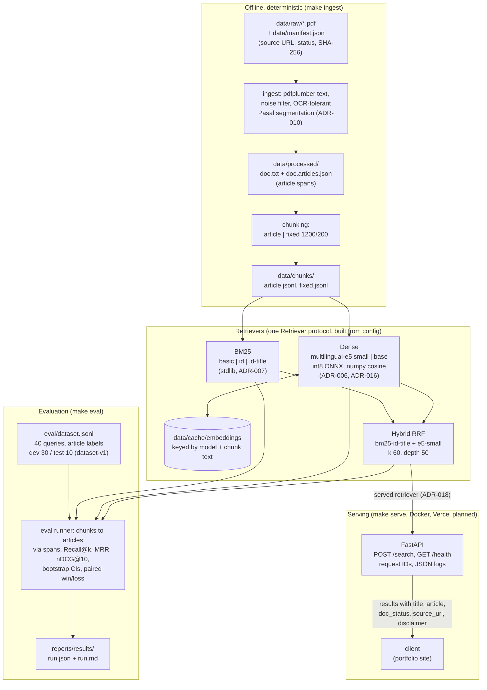

# Architecture (T-30)

Offline steps write files; the eval runner and the API build the same retrievers from the same chunk files, so the API serves what was benchmarked (design.md 1).

CI runs lint, type checks and the tests, including a deterministic eval on a fictional fixture corpus with a metric floor (T-15), then builds the Docker image from that fixture and smoke-tests `/health` and `/search` (T-28).
